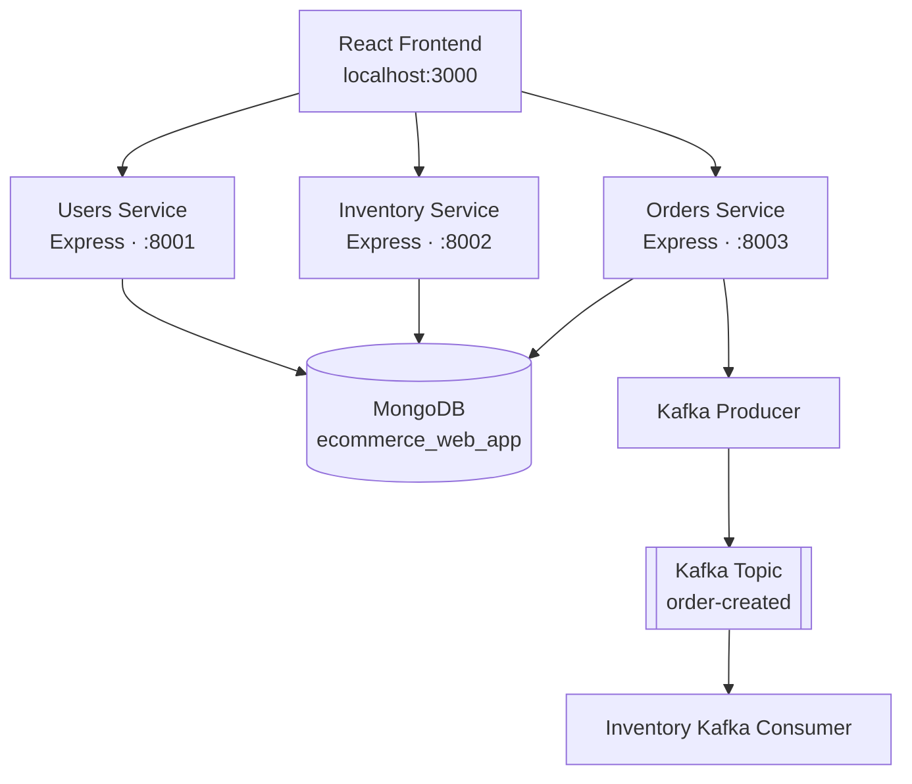
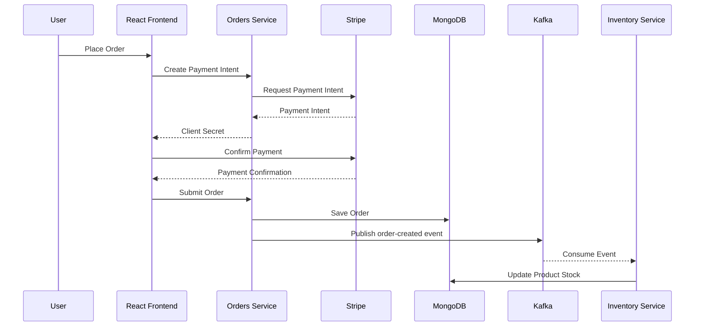

<div align="center">

# 🛒 Amazon Clone — Full-Stack E-Commerce Platform

### A Modern E-Commerce Application Built with React, Node.js, Microservices & Apache Kafka

[](https://react.dev/)
[](https://nodejs.org/)
[](https://expressjs.com/)
[](https://www.mongodb.com/)
[](https://kafka.apache.org/)
[](https://www.docker.com/)

</div>

---

## 📌 Overview

Amazon Clone is a full-stack e-commerce web application inspired by the core shopping experience of Amazon.

The application combines a React frontend with a backend powered by Node.js, Express.js, MongoDB, and a microservices architecture.

It consists of three independent backend services:

- **Users Service** – Handles user registration and login.
- **Inventory Service** – Manages products and inventory information.
- **Orders Service** – Handles payment-intent creation and order management.

The application uses MongoDB for persistent data storage and Apache Kafka for asynchronous communication between backend services. Docker Compose provides containerized infrastructure for running the backend ecosystem.

This project demonstrates practical implementation of:

- Full-stack web development.
- RESTful API development.
- Microservices architecture.
- Event-driven communication.
- Database integration.
- Payment gateway integration.
- Docker-based containerization.

> **Project Status:** This README documents the implementation present in the repository. Some runtime and configuration issues remain and are listed in the Known Issues section. The project should not be considered production-ready until these issues are addressed.

---

## ✨ Features

### 🛍️ Shopping Experience

- Browse products from the product catalogue.
- View product images, names, prices, and ratings.
- Add products to the shopping cart.
- Remove products from the cart.
- Automatically calculate the cart subtotal.
- Responsive shopping interface.
- Mobile-specific navigation and search layout.

### 👤 User Management

- User registration with name, email, and password.
- User login with password verification.
- Password hashing using `bcryptjs`.
- Basic sign-out functionality.
- User information stored in browser `localStorage`.

### 📦 Checkout & Orders

- Shipping-address form.
- Order review before payment.
- Stripe Payment Intents integration.
- Card payment interface using Stripe Elements.
- Order creation and storage in MongoDB.
- Order-history retrieval by email address.

### ⚙️ Backend Architecture

- Three independent Express.js services.
- MongoDB integration using Mongoose.
- Kafka producer and consumer implementation.
- Event-driven inventory updates.
- Separate backend service configurations.
- Dockerfiles for frontend and backend services.
- Docker Compose configuration for backend infrastructure.

---

## 🧰 Technology Stack

| Category | Technologies |
|---|---|
| Frontend | React 17, React Router 6 |
| UI & Styling | Styled Components, Material UI |
| State Management | React Context API, useReducer |
| HTTP Client | Axios |
| Backend | Node.js, Express.js |
| Database | MongoDB, Mongoose |
| Authentication Utilities | bcryptjs |
| Payment Gateway | Stripe, Stripe Elements |
| Message Broker | Apache Kafka |
| Kafka Client | KafkaJS |
| Coordination | Apache ZooKeeper |
| Containerization | Docker, Docker Compose |
| Testing Tools | Jest-style tests, Supertest |

---

## 🏗️ System Architecture

The application follows a frontend + microservices architecture.

The React frontend communicates with three independent backend services through REST APIs.

Each service handles a specific business responsibility, while MongoDB provides persistent storage.

Apache Kafka enables asynchronous communication between the Orders Service and Inventory Service.

### Architecture Diagram



### Microservices Overview

| Service | Port | Responsibility |
|---|---:|---|
| Users Service | `8001` | User registration and login |
| Inventory Service | `8002` | Product creation, retrieval, and stock updates |
| Orders Service | `8003` | Payment-intent creation and order management |

### 🔄 Order Processing Workflow

The application uses Kafka to communicate order-related events between services.

The general workflow is:

1. A customer adds products to the shopping cart.
2. The customer proceeds to checkout.
3. The frontend requests a payment intent from the Orders Service.
4. Stripe Elements handles the card payment confirmation.
5. The frontend submits the order information to the Orders Service.
6. The Orders Service stores the order in MongoDB.
7. The Orders Service publishes an `order-created` event to Kafka.
8. The Inventory Service consumes the event.
9. The Inventory Service updates the stock quantities of the ordered products.

### Event Flow Diagram



> **Note:** The current implementation does not fully validate Stripe payment status before proceeding with order creation. Kafka publishing and inventory updates also need additional reliability mechanisms. This workflow describes the intended integration, not a production-grade payment guarantee.

---

## 📁 Project Structure

The repository contains separate frontend and backend applications.

The application source is located inside the `AmazonCloneProject-main/` directory.

```text
Amazon-Clone-Project-main/
│
├── .gitignore
│
└── AmazonCloneProject-main/
    │
    ├── README.md
    │
    ├── amazon-clone-frontend-main/
    │   └── amazon-clone-frontend-main/
    │       │
    │       ├── public/
    │       ├── build/
    │       │
    │       ├── src/
    │       │   ├── Components/
    │       │   │   ├── AddProduct.js
    │       │   │   ├── Address.js
    │       │   │   ├── Card.js
    │       │   │   ├── Checkout.js
    │       │   │   ├── Home.js
    │       │   │   ├── Login.js
    │       │   │   ├── Navbar.js
    │       │   │   ├── Orders.js
    │       │   │   ├── Payment.js
    │       │   │   └── SignUp.js
    │       │   │
    │       │   ├── App.js
    │       │   ├── StateProvider.js
    │       │   ├── reducer.js
    │       │   ├── axios.js
    │       │   ├── index.js
    │       │   └── index.css
    │       │
    │       ├── Dockerfile
    │       └── package.json
    │
    └── amazon-clone-backend-main/
        └── amazon-clone-backend-main/
            │
            ├── UsersService/
            │   ├── configs/
            │   ├── models/
            │   ├── server.js
            │   ├── Dockerfile
            │   └── package.json
            │
            ├── InventoryService/
            │   ├── configs/
            │   ├── models/
            │   ├── services/
            │   ├── shared/kafka/
            │   ├── server.js
            │   ├── Dockerfile
            │   └── package.json
            │
            ├── OrdersService/
            │   ├── configs/
            │   ├── models/
            │   ├── shared/kafka/
            │   ├── server.js
            │   ├── Dockerfile
            │   └── package.json
            │
            ├── tests/
            │   └── server.test.js
            │
            └── docker-compose.yml
```

---

## 🚀 Getting Started

Follow these instructions to set up the project on your local machine.

### 1. Prerequisites

Make sure you have the following installed:

| Software | Purpose |
|---|---|
| Node.js 16+ | JavaScript runtime |
| npm | Package management |
| MongoDB | Database |
| Docker Desktop | Containerization |
| Docker Compose | Multi-container orchestration |
| Stripe Account | Payment integration |

Download the required software:

- [Node.js](https://nodejs.org/)
- [MongoDB](https://www.mongodb.com/try/download/community)
- [Docker Desktop](https://www.docker.com/products/docker-desktop/)
- [Stripe](https://stripe.com/)

Verify your installations:

```bash
node --version
npm --version
docker --version
docker compose version
```

### 2. Clone the Repository

```bash
git clone <your-repository-url>
```

Navigate to the repository:

```bash
cd <repository-folder>
```

Then enter the actual application directory:

```bash
cd AmazonCloneProject-main
```

Replace `<your-repository-url>` and `<repository-folder>` with your actual GitHub repository URL and directory name.

### 3. Configure the Backend

The backend consists of three independent services.

Each service must be installed and started separately.

#### 👤 Users Service

Open a terminal:

```bash
cd amazon-clone-backend-main/amazon-clone-backend-main/UsersService

npm install

node server.js
```

Users Service:

```text
http://localhost:8001
```

#### 📦 Inventory Service

Open another terminal:

```bash
cd amazon-clone-backend-main/amazon-clone-backend-main/InventoryService

npm install

node server.js
```

Inventory Service:

```text
http://localhost:8002
```

#### 🧾 Orders Service

Open another terminal:

```bash
cd amazon-clone-backend-main/amazon-clone-backend-main/OrdersService

npm install

node server.js
```

Orders Service:

```text
http://localhost:8003
```

> **Important:** The Orders Service currently contains a syntax error and a missing dependency. Resolve the issues documented in the Known Issues section before expecting it to start successfully.

### 4. Configure MongoDB

The application uses MongoDB as its primary database.

The configured local connection string is:

```text
mongodb://localhost:27017/ecommerce_web_app
```

Make sure MongoDB is running before starting the backend services.

### 5. Configure Apache Kafka

The Inventory and Orders services use Kafka for event-driven communication.

The default local Kafka broker address is:

```text
localhost:9092
```

Start Kafka and ZooKeeper through the supplied Docker Compose configuration or use an equivalent Kafka installation.

### 6. Configure Stripe

The application integrates Stripe for payment processing.

Create a Stripe account and obtain your API keys from:

https://dashboard.stripe.com/apikeys

Configure the backend secret key using an environment variable:

```env
STRIPE_SECRET_KEY=your_stripe_secret_key
```

The frontend also contains a Stripe publishable key in `src/App.js`.

For a safer configuration, move it into a frontend environment variable:

```env
REACT_APP_STRIPE_PUBLISHABLE_KEY=your_publishable_key
```

Update the frontend code to read this variable.

**Security guidelines:**

- Never expose your Stripe secret key in frontend code.
- Never commit private API keys to GitHub.
- Use Stripe test mode during development.
- Keep environment files out of version control.

### 7. Start the Frontend

Open another terminal:

```bash
cd AmazonCloneProject-main/amazon-clone-frontend-main/amazon-clone-frontend-main

npm install

npm start
```

The React application should be available at:

**http://localhost:3000**

### Frontend API Configuration

The frontend communicates with the backend through Axios instances configured in:

```text
src/axios.js
```

The current service URLs are:

| Backend Service | URL |
|---|---|
| Users Service | `http://localhost:8001` |
| Inventory Service | `http://localhost:8002` |
| Orders Service | `http://localhost:8003` |

---

## 🐳 Docker Deployment

The backend includes Dockerfiles for individual services and a Docker Compose configuration.

The Compose file is located at:

```text
amazon-clone-backend-main/amazon-clone-backend-main/
```

### Start Backend Infrastructure

Navigate to the directory containing `docker-compose.yml`:

```bash
cd amazon-clone-backend-main/amazon-clone-backend-main
```

Build and start the services:

```bash
docker compose up --build
```

### Docker Services

| Service | Port | Purpose |
|---|---:|---|
| ZooKeeper | `2181` | Kafka coordination |
| Kafka | `9092` | Event streaming |
| MongoDB | `27017` | Database |
| Users Service | `8001` | User management |
| Inventory Service | `8002` | Product management |
| Orders Service | `8003` | Order management |

### Stop Docker Containers

```bash
docker compose down
```

### View Running Containers

```bash
docker ps
```

> **Docker Note:** The supplied Compose configuration covers the backend infrastructure and services, not the React frontend. The frontend has a separate Dockerfile and can be built independently after resolving its configuration requirements.

---

## 🔌 API Documentation

The backend exposes RESTful APIs through three independent services.

### 👤 1. Users Service

**Base URL:**

```text
http://localhost:8001
```

| Method | Endpoint | Description |
|---|---|---|
| GET | `/` | Basic service response |
| POST | `/auth/signup` | Register a new user |
| POST | `/auth/login` | Authenticate a user |

#### User Registration

**Endpoint:**

```http
POST /auth/signup
```

Request body:

```json
{
  "fullName": "John Doe",
  "email": "john@example.com",
  "password": "your-password"
}
```

#### User Login

**Endpoint:**

```http
POST /auth/login
```

Request body:

```json
{
  "email": "john@example.com",
  "password": "your-password"
}
```

Passwords are hashed using `bcryptjs` before being stored in MongoDB.

> **Security Note:** The current login implementation returns the user document, including its password hash. This should be corrected before production use.

---

### 📦 2. Inventory Service

**Base URL:**

```text
http://localhost:8002
```

| Method | Endpoint | Description |
|---|---|---|
| GET | `/` | Basic service response |
| POST | `/products/add` | Add a new product |
| GET | `/products/get` | Retrieve all products |

#### Add Product

**Endpoint:**

```http
POST /products/add
```

Request body:

```json
{
  "title": "Wireless Headphones",
  "imageURL": "https://example.com/headphones.jpg",
  "price": 2499,
  "noOfItems": 25,
  "rating": 4.5
}
```

#### Get Products

**Endpoint:**

```http
GET /products/get
```

Returns the available products from the inventory database.

---

### 🧾 3. Orders Service

**Base URL:**

```text
http://localhost:8003
```

| Method | Endpoint | Description |
|---|---|---|
| GET | `/` | Basic service response |
| POST | `/payment/create` | Create Stripe Payment Intent |
| POST | `/orders/add` | Create and save an order |
| POST | `/orders/get` | Retrieve orders by email |

#### Create Payment Intent

**Endpoint:**

```http
POST /payment/create
```

Request body:

```json
{
  "amount": 2499
}
```

#### Create Order

**Endpoint:**

```http
POST /orders/add
```

Request body:

```json
{
  "basket": [
    {
      "id": "PRODUCT_ID",
      "title": "Wireless Headphones",
      "price": 2499,
      "image": "https://example.com/headphones.jpg",
      "rating": 4.5
    }
  ],
  "price": 2499,
  "email": "john@example.com",
  "address": {
    "fullName": "John Doe",
    "phone": "9999999999",
    "flat": "12A",
    "area": "Example Road",
    "city": "Kolkata",
    "state": "West Bengal"
  }
}
```

#### Retrieve Orders

**Endpoint:**

```http
POST /orders/get
```

Request body:

```json
{
  "email": "john@example.com"
}
```

---

## 📨 Apache Kafka Integration

Apache Kafka is used to enable asynchronous communication between the Orders Service and Inventory Service.

The project implements a producer-consumer architecture.

### Kafka Configuration

| Configuration | Value |
|---|---|
| Message Broker | Apache Kafka |
| Kafka Client | KafkaJS |
| Topic | `order-created` |
| Producer | Orders Service |
| Consumer | Inventory Service |
| Consumer Group | `inventory-group` |

### How It Works

1. A customer places an order.
2. The Orders Service saves the order in MongoDB.
3. The Orders Service publishes an `order-created` event.
4. Kafka receives and distributes the event.
5. The Inventory Service consumes the event.
6. The Inventory Service updates the stock quantities.

This approach separates order processing from inventory management and demonstrates event-driven microservices communication.

---

## 🧪 Testing

The repository contains a test file:

```text
amazon-clone-backend-main/amazon-clone-backend-main/tests/server.test.js
```

The test file uses Jest-style test cases and Supertest to describe checks for:

- Service responses.
- User registration.
- User authentication.
- Product operations.
- Payment operations.
- Order management.

**Current testing status:**

The repository does not contain a complete, verified test configuration.

The existing test file references a server entry point and database helpers that do not match the three-service directory structure. The backend package manifests also do not provide a working Jest test script.

Therefore, the existing tests should be treated as test intentions rather than confirmed passing tests.

Recommended testing improvements:

- Configure tests independently for each microservice.
- Use an isolated test database.
- Mock Stripe payment operations.
- Mock Kafka producer and consumer operations where appropriate.
- Add API integration tests.
- Add automated test execution through GitHub Actions.

---

## ⚠️ Known Issues & Setup Notes

The following issues were identified during source-code inspection.

These are important considerations before running or deploying the application.

| # | Issue | Recommended Improvement |
|---|---|---|
| 1 | Orders Service contains an extra closing `);` after Stripe initialization. | Correct the syntax error. |
| 2 | Inventory and Orders services lack npm start scripts. | Add start scripts or modify their Docker commands. |
| 3 | Orders Service uses `dotenv` without declaring it in its package dependencies. | Add the missing dependency if `.env` loading is required. |
| 4 | Stripe publishable key is hard-coded in frontend code. | Move it to environment-based configuration. |
| 5 | Stripe payment status is not fully validated before order creation. | Verify payment status before proceeding. |
| 6 | Authentication does not implement JWT or session-based authentication. | Implement secure authentication. |
| 7 | Login response includes the stored password hash. | Return a sanitized user object. |
| 8 | Order retrieval relies on an email supplied in the request body. | Implement user-level authorization. |
| 9 | Kafka producer errors are handled internally without propagating failure to the order route. | Add proper error propagation and retry handling. |
| 10 | Kafka consumer inventory updates are not fully awaited. | Improve asynchronous processing and error handling. |
| 11 | Inventory updates do not verify sufficient stock before decrementing quantities. | Add stock validation and atomic updates. |
| 12 | Cart and shipping details are not persisted across browser refreshes. | Implement persistent cart and checkout state. |
| 13 | Docker Compose dependency ordering does not guarantee database and Kafka readiness. | Add health checks and readiness handling. |
| 14 | Existing test configuration does not match the microservices directory structure. | Configure independent service tests. |

> These issues are documented transparently so that the README reflects the actual state of the submitted source code rather than claiming unverified production functionality.

---

## 🔮 Future Improvements

The project can be extended with several additional features and architectural improvements.

### 🔐 Authentication & Security

- [ ] Implement JWT-based authentication.
- [ ] Add protected routes.
- [ ] Implement role-based authorization.
- [ ] Secure API endpoints.
- [ ] Sanitize API responses.
- [ ] Add request validation and rate limiting.

### 🛍️ E-Commerce Features

- [ ] Product search functionality.
- [ ] Product category filtering.
- [ ] Product sorting.
- [ ] Product quantity selection.
- [ ] Persistent shopping cart.
- [ ] Wishlist functionality.
- [ ] Product reviews and ratings.
- [ ] Improved order tracking.

### ⚙️ Backend Improvements

- [ ] Improve microservice communication.
- [ ] Implement reliable Kafka event processing.
- [ ] Add Kafka retry and idempotency mechanisms.
- [ ] Implement inventory validation.
- [ ] Improve API error handling.
- [ ] Add centralized logging.
- [ ] Add Swagger / OpenAPI documentation.

### 💳 Payment Improvements

- [ ] Implement secure Stripe payment confirmation.
- [ ] Add Stripe webhook handling.
- [ ] Implement order payment status tracking.
- [ ] Improve transaction consistency.

### 🚀 DevOps & Deployment

- [ ] Complete Docker-based frontend deployment.
- [ ] Improve Docker health checks.
- [ ] Add environment-based configuration.
- [ ] Implement CI/CD using GitHub Actions.
- [ ] Add automated testing.
- [ ] Deploy the application to a cloud platform.
- [ ] Add application monitoring.

---

## 🤝 Contributing

Contributions, suggestions, and improvements are welcome!

If you would like to contribute:

1. Fork this repository.
2. Create a new feature branch.

   ```bash
   git checkout -b feature/your-feature-name
   ```

3. Make your changes.
4. Commit your changes.

   ```bash
   git commit -m "Add: your feature description"
   ```

5. Push your branch.

   ```bash
   git push origin feature/your-feature-name
   ```

6. Open a Pull Request.

---

## 📄 License

No license file was present in the submitted project archive.

Add a `LICENSE` file to define the permissions and conditions under which others may use, modify, and distribute this project.

---

## ⚖️ Disclaimer

This is an independent educational project inspired by the shopping experience of Amazon.

It is not affiliated with, endorsed by, or sponsored by Amazon.

Amazon and all related trademarks, logos, and brand assets belong to their respective owners.

---

<div align="center">

### 🚀 Built with passion for Full-Stack Development

**Exploring React • Node.js • Microservices • MongoDB • Apache Kafka**

⭐ If you find this project interesting, consider giving it a star!

</div>
